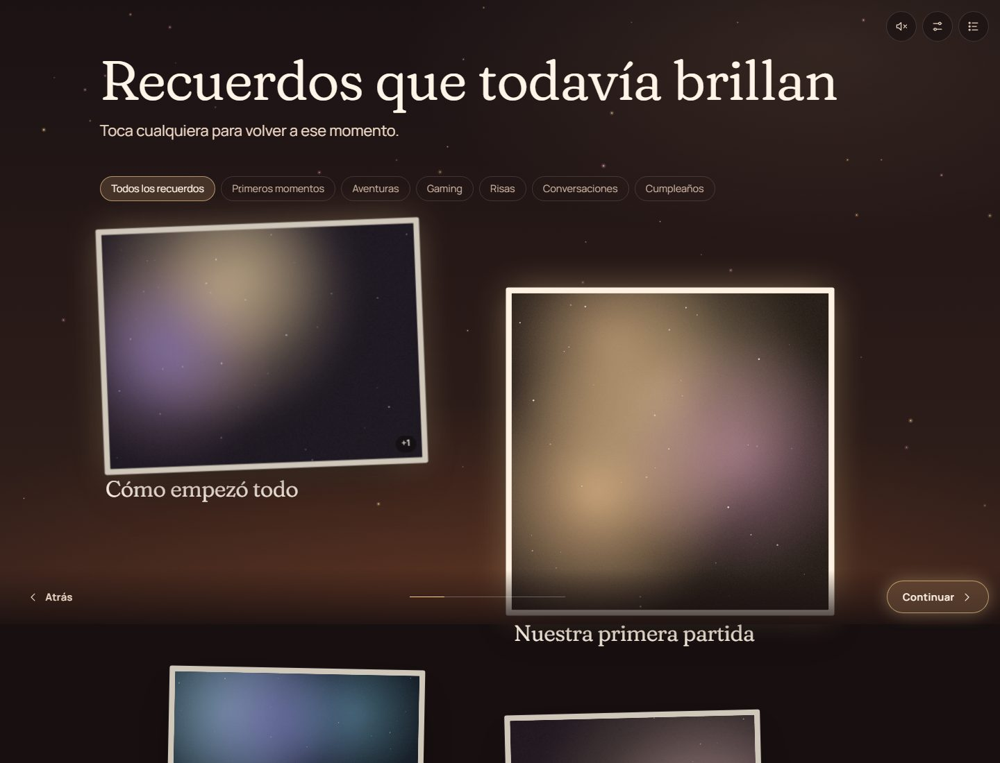
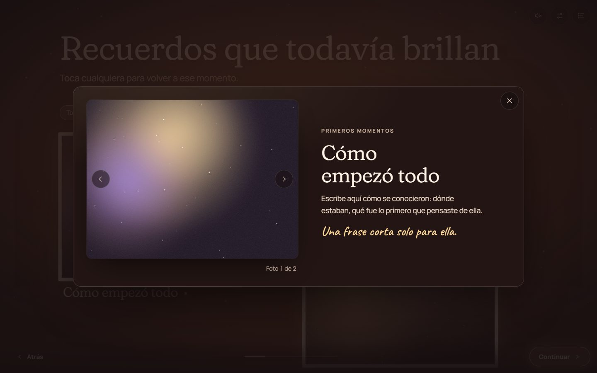
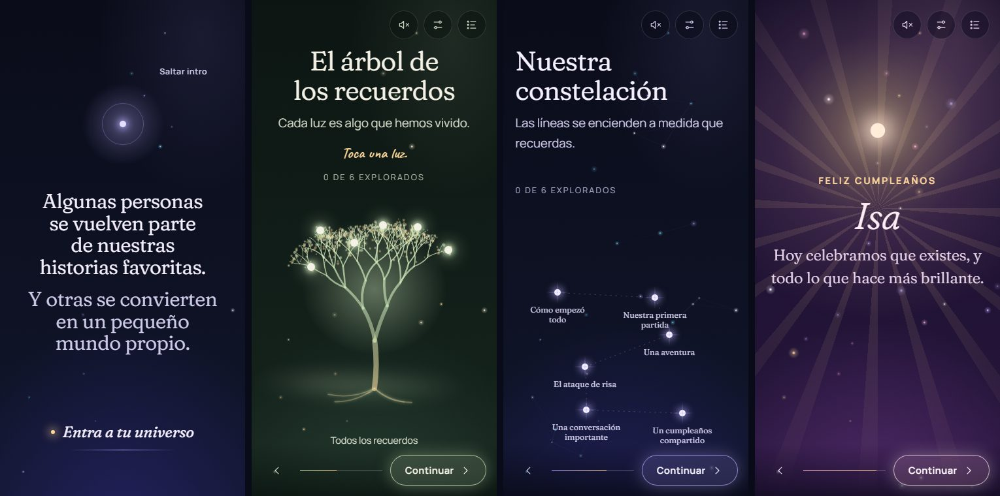

# AFTERGLOW

_Every memory leaves a little light behind._ — _Cada recuerdo deja un poquito de luz._

AFTERGLOW is a reusable, configurable storytelling engine for personalised digital
experiences: birthdays, friendships, anniversaries, farewells, graduations, tributes.
A visitor doesn't scroll a page — they enter a small night sky built from someone's
memories, open photographs that surface like developing prints, touch the lights of a
living tree, connect a constellation, read a letter, and reach a finale that gathers
the light collected along the way.

The first experience is a birthday dedication for **Isa** (`src/experiences/isa`).
Its personal content is intentionally placeholder: nothing about her has been invented.

| Arrival                                  | Memories                                   | Tree of Memories                   |
| ---------------------------------------- | ------------------------------------------ | ---------------------------------- |
|  |  |  |

| A memory, opened                              | Birthday finale                        |
| --------------------------------------------- | -------------------------------------- |
|  |  |



## Features

- **Nine scene types** — arrival, memories, tree, constellation, timeline, names &
  inside jokes, message/letter, celebration finale, closing. Any subset, any order.
- **Typed, validated configuration** — one file per experience; clear errors in
  development, a calm fallback in production.
- **Per-deployment URLs** — e.g. `wembie.github.io/mejoramigaisa`, set by a deployment profile.
- **Living visuals** — per-scene themes that crossfade, a shared canvas particle engine,
  a procedural SVG tree with energy trails, kinetic typography that stays real text.
- **Optional sound** — asked, never assumed; generative pads (no licensing), your own
  tracks, crossfades, synthesised chimes with gentle stereo placement.
- **Accessible** — keyboard, screen readers, reduced motion, reading mode, 44 px targets,
  tested contrast.
- **Fast** — 84 KB gzipped initial JS, lazy scenes, no 3D library.
- **Private by default where it can be** — no analytics, no trackers, no external
  requests; only the chosen experiences are bundled; `noindex`.

## Requirements

Node.js ≥ 20.19 (22 recommended, see `.nvmrc`) and npm.

## Quick start

```bash
npm install
npm run dev            # http://localhost:5173/#/isa
```

| Script                                      | What it does                                                 |
| ------------------------------------------- | ------------------------------------------------------------ |
| `npm run dev`                               | Local development server                                     |
| `npm run build` / `preview`                 | Production build / serve it                                  |
| `npm run validate`                          | Format check, lint, type check, unit tests, build            |
| `npm test` / `npm run test:e2e`             | Vitest / Playwright (`npx playwright install chromium` once) |
| `npm run new-experience -- <slug> "<Name>"` | Scaffold a new experience                                    |
| `npm run photos -- <slug>`                  | Print `assets.images` entries with real dimensions           |
| `node scripts/profile.mjs check <profile>`  | Verify a deployment's URL and target agree                   |

## Configuring an experience

Everything personal lives in `src/experiences/<slug>/experience.ts` and
`public/experiences/<slug>/`. A memory, for example:

```ts
memories: [
  {
    id: 'primera-partida',
    title: 'Nuestra primera partida',
    date: { precision: 'month', year: 2021, month: 6 },
    category: 'gaming',
    description: 'El juego, el equipo, el momento que todavía recuerdan.',
    message: 'Una frase corta solo para ella.',
    photos: ['partida-1', 'partida-2'],   // ids from assets.images
  },
],
```

- **Photos** — put them in `public/experiences/<slug>/photos/`, run
  `npm run photos -- <slug>`, paste the entries into `assets.images`, write alt text.
- **Music** — put files in `public/experiences/<slug>/audio/` and add
  `{ source: 'file', src: 'audio/song.mp3' }` to `audio.tracks`, or use
  `{ source: 'generative', preset: 'night-pad' }`. Assign tracks to scenes with `music`.
- **Messages** — `messages: [{ id, kind: 'letter', body, signature, reveal: 'fade' }]`,
  shown by a `message` scene, the celebration or the closing.
- **Scenes** — the `scenes` array is the story. Reorder, remove or repeat freely.

Full reference: [docs/CONTENT_CONFIGURATION.md](docs/CONTENT_CONFIGURATION.md).
Photo and audio preparation: [docs/ASSET_PIPELINE.md](docs/ASSET_PIPELINE.md).

### A new experience for someone else

```bash
npm run new-experience -- sam "Sam" --locale en --path para-sam
```

No engine code changes. `src/experiences/friend-example` shows a deliberately different
experience (English, farewell, three scenes).

## Deploying to GitHub Pages with your own URL

Each published experience has a **deployment profile** in `deployments/<name>.env`:

```ini
AFTERGLOW_SITE_URL=https://wembie.github.io/mejoramigaisa
AFTERGLOW_EXPERIENCES=isa
PAGES_TARGET_REPO=Wembie/mejoramigaisa
```

The URL's path (`/mejoramigaisa/`) becomes the build's base path. Because GitHub Pages
serves each repository at `/<repository-name>/`, the workflow publishes the build to a
repository with that name (or into a folder of your user site). After tests pass, every
push to `main` rebuilds and publishes every profile.

> **En español:** la URL de cada despliegue se define en `deployments/<nombre>.env` con
> `AFTERGLOW_SITE_URL`. Para `wembie.github.io/mejoramigaisa`: crea el repositorio vacío
> `Wembie/mejoramigaisa`, agrega el secreto `PAGES_DEPLOY_TOKEN` en este repositorio,
> haz push a `main` y activa Pages (rama `gh-pages`) en el repositorio destino.
> Los pasos completos están en [docs/DEPLOYMENT.md](docs/DEPLOYMENT.md).

One-time setup, variables and alternatives: [docs/DEPLOYMENT.md](docs/DEPLOYMENT.md).

## Architecture

React + TypeScript + Vite, Zod validation, semantic HTML with SVG and a single Canvas
2D layer, Web Audio. No Three.js (see the reasoning in
[docs/ARCHITECTURE.md](docs/ARCHITECTURE.md)). Design system and art direction:
[docs/ART_DIRECTION.md](docs/ART_DIRECTION.md).

## Accessibility and performance

[docs/ACCESSIBILITY.md](docs/ACCESSIBILITY.md) · [docs/PERFORMANCE.md](docs/PERFORMANCE.md)

## Testing

- **Unit/component (Vitest)** — schema validation, defaults and broken references, build
  env and base paths, router, dates, audio manager (gesture unlock, single context, mute,
  volumes, missing files, no Web Audio), preferences (corrupt storage), tree/constellation
  generators, theme contrast, and the runner: navigation, galleries, missing photos,
  keyboard, reduced motion, unknown scene types.
- **Browser (Playwright)** — the production build served at `/mejoramigaisa/` on desktop
  and a 375 px phone: full journey without audio, tree exploration, mobile overflow and
  touch, reduced motion, missing photos, base-path assets, unknown-experience redirect.

## Versioning

Semantic Versioning; current version in [`VERSION`](VERSION), history in
[`CHANGELOG.md`](CHANGELOG.md). Configuration schema changes bump `schemaVersion`
and the major version, with a migration guide.

## Privacy

A GitHub Pages site is **public**. An unguessable URL is not protection: anyone with the
link can open the experience and download its photos and audio. Publish only what the
recipient would be happy to see on the open web. AFTERGLOW adds no analytics, cookies,
trackers or third-party requests; visitor preferences stay in their own browser.

## Known limitations

- The Isa experience contains placeholders until real memories, photos and the letter
  are added.
- Image optimisation is a manual step (no image-processing dependency).
- Link previews use the profile's title/description/image, not per-experience data.
- No automated axe audit yet; screen-reader behaviour is verified through tests, not
  manual NVDA/VoiceOver sessions.
- The GitHub Pages deployment (journey G) has not been run from this machine; the
  workflow and base paths are verified locally with a production build.

## License

MIT — see [LICENSE](LICENSE).
